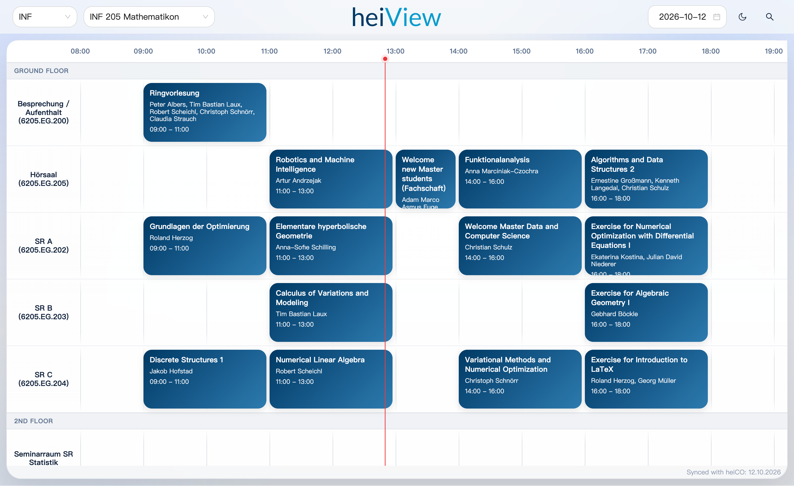

<div align="center">
  <a href="https://heiview.de/" target="_blank" rel="noopener noreferrer">
    
  </a>
  </br>
  
  </br>
  <a href="https://heiview.de/" target="_blank" rel="noopener noreferrer"> https://heiview.de </a>
</div>

</br>

<div align="center">

[English](#english-version) | [中文版](#chinese-version)

</div>

<a id="english-version"></a>
### Introduction

Tired of cryptic building addresses in heiCO? Exhausted by needing to connect VPN just to check a classroom? Uncertain whether your preferred study room will be occupied when you need it?

These seemingly small inconveniences affect the daily experience of Heidelberg University students. That's why heiView was created.

By restructuring campus building and classroom data across all campuses and combining it with an intuitive timeline view, you can now quickly check any classroom's course schedule and occupancy status.

Whether you're looking for a quiet room to study, or exploring courses and activities of interest, heiView empowers you to stay informed about campus-wide schedules anytime, anywhere.

### Core Features

- **Interactive Timeline Visualization**: Intuitively displays daily course schedules and idle time slots across all classrooms in campus buildings.
- **Detailed Course Information**: Click on any course card in the timeline to view full details, including direct heiCO links.
- **Add to Calendar**: Export any course to Google Calendar or download a standard `.ics` file compatible with Apple Calendar and Outlook.
- **Building independent bookmarks**: Each building has its own exclusive URL. It is recommended to switch to a frequently visited building before saving the bookmark.
- **Global cross-date search**: Supports searching all courses by any keyword. Clicking on a search result allows you to view course details and jump directly to the corresponding building and date.
- **User Feedback**: Users can report incorrect course times or rooms directly from the course card, optionally attaching screenshots and a contact email.

### Building Catalog

The `data/building-catalog.json` file is a data dictionary generated from the classroom information in the heiCO course, supplemented by a large number of manual modifications. It is used to record the affiliation and alias relationships of different campuses, buildings and classrooms. For example, Grabengasse 3-5 is displayed as Neue Universität for easy understanding, and Voßstraße 2 is divided into 10 different buildings to avoid new students getting lost, etc.

There are still some contents to be improved, such as incomplete building floors, adding common abbreviations to the buildings and information about the facilities inside the classroom (whether there are sockets and air conditioners, etc.).

### To Do List

Due to incomplete and inconsistently formatted data in heiCO, over 700 courses in the 2026 Summer Semester lack time and location information. These courses are currently placed under "Other → No Information" and some courses with incomplete information are also placed in "Other"， require manual updating.

**We warmly welcome contributions!** You can:

- Join the project as a long-term editor to help complete course data, my student email id is ht305.
- Create Issues to report missing or incorrect information
- Submit Pull Requests to update the file directly

### Local Testing & Development

**1. Install Dependencies**
```bash
npm install
```

**2. Crawl Courses and Resume Tasks**

Use Python 3.10+ and install the crawler dependencies and Chromium:
```bash
python -m pip install -r crawler/requirements.txt
python -m playwright install chromium
python heiview
# Equivalent menu entry point:
python -m crawler
```
Course access may require the campus network or university VPN. In the menu, choose `1`/`crawl`, select a semester, then configure forward/reverse crawling or detail URLs. Enter accepts the displayed default, `b` goes back, `q` exits, and `e` edits the execution summary. Ctrl+C cancels the current task and returns to the menu; Ctrl+C at the main menu exits.

If the selected semester has an unfinished task from the same **Europe/Berlin calendar day**, the menu offers to resume it, configure a new task, or return. The original options and progress are displayed. Completed limited/URL tasks are not treated as interrupted. Tasks from another day and corrupted/incompatible checkpoints cannot resume; the menu explains why.

Each semester stores an atomic `checkpoint.json`. Every successful course is journaled immediately, even while concurrent requests are running. Resume retries failed/pending courses before continuing from the saved pagination position and does not rescan successful pages or course details. The original count limit counts distinct selected courses across all attempts; retries do not consume new positions. Changing the source website's list order during a task can still change page membership; start a new full crawl if the list changes substantially.

Direct calls remain supported; **2026WS** is the default:
```bash
python crawler/heico_crawler.py --semester 2026WS -n 5
python crawler/heico_crawler.py --semester 2026WS --reverse --skip 20 -n 5
python crawler/heico_crawler.py --semester 2026SS --skip 200 --concurrency 3
python crawler/heico_crawler.py --semester 2026WS --url "COURSE_DETAIL_URL"
```
`--number` and `--concurrency` must be positive, `--skip` nonnegative. Forward skip counts from the beginning; reverse skip counts from the end, with automatic last-page discovery. Repeat `--url` for multiple detail URLs; URL mode rejects reverse, a nonzero skip and count limits. Ensure URLs belong to the selected semester. `--show-browser` displays Chromium. Checkpoint resumption is offered through the menu; direct invocations start new tasks.

`last-run.json` records each task's result. `sync-meta.json` records only a successful full-coverage task: original skip=0, no count limit, no URL override, all courses successful. Full forward **and reverse** tasks qualify, including tasks completed after same-day resumption. Statistics and removal checks combine the whole task's course set. Partial/failed/interrupted or empty runs preserve the previous full-sync metadata and do not archive courses. Verification errors keep existing course files.

**3. Automatic and Manual Database Sync**

After every successful crawl, including a limited or URL task, the crawler automatically runs `npm run db:sync` for that semester. Failed/interrupted crawls do not trigger it. The checkpoint records crawl and database sync states independently: if the database step fails, the menu offers **sync only**, so courses need not be crawled again. CLI failures return a nonzero exit code. There is no deployment step.

Choose `2`/`sync`/`db` in the menu to manually select a semester and build its database, or run:
```bash
HEIVIEW_SEMESTER=2026WS npm run db:sync
HEIVIEW_SEMESTER=2026SS npm run db:sync
```
The default target is configured in `config/semesters.json`. The same semester is used by catalog patching, course/override/custom/skip import, building import and metadata import. Missing, empty or invalid source courses fail before replacing a database. The complete database is built in a temporary file and published only when all steps succeed; other semester databases remain intact. A lock prevents simultaneous syncs for the same semester, and admin writes are rejected while it is building. `HEIVIEW_DATA_DIR` can point to an isolated data directory for testing.

Semester source files under `data/2026SS/` and `data/2026WS/` are git-ignored and stay local. Generated semester databases live directly under `data/`, named `2026SS.db`, `2026WS.db`, and so on. Commit and push the corresponding database file to publish an update. The deployment workflow then updates the remote database while leaving local course source files untouched.

Database layout:
```text
data/2026SS/{course-*.json,overrides/,custom/,skip/,feedback/,checkpoint.json,sync-meta.json}
data/2026WS/{course-*.json,overrides/,custom/,skip/,feedback/,checkpoint.json,sync-meta.json}
data/2026SS.db
data/2026WS.db
```
Shared building catalogs and location maps stay under `data/`. The previous `data/heiview.db` has been renamed to `data/2026SS.db`, and `data/2026WS/heiview.db` to `data/2026WS.db`. For older installations that still have `data/heiview.db`, it remains a **2026SS** fallback when `data/2026SS.db` is absent. Rebuilding SS creates the new database; the first authenticated SS admin write also makes a SQLite copy before editing, preserving the legacy file. WS and other semesters never fall back to it. The legacy shared `data/sync-meta.json` still receives full SS crawl updates; new builds read semester metadata, with the matching legacy SS record as an initial fallback. Existing shared further-information skip records are likewise retained for SS only.

The public site loads **only the selected day's schedule**, defaulting to today's Berlin date (or a valid `?date=YYYY-MM-DD` URL). April–September maps to that year's SS; October–March maps to WS beginning in October (January–March belongs to the previous year's WS). Thus 2026-09-30 → 2026SS, 2026-10-01 and 2027-03-31 → 2026WS. Historic dates/semesters are requested only when selected, without background crawling or historical prefetch. Missing semester databases show “data not ready”, distinct from an empty day or request error.

Search spans dates within the selected semester. Details, feedback, calendar export and admin edits retain the course's semester, including courses with the same ID in different semesters. API request context and caches are semester-specific. Published database versions invalidate old schedule cache keys, and database connections are reopened for each request. Admin date selection determines its editing semester; changing semester clears open editor state.

`config/semesters.json` is the shared Python/Node/frontend registry for term IDs, default semester, timezone and month boundaries. Add future heiCO IDs there; APIs can report an unprepared semester even when it has no registered term ID yet.

Verification uses temporary data and mocked crawls, not the project database:
```bash
python -m unittest discover -s tests -v
node --test tests/semester-api.test.cjs
npm run build
# Browser checks (requires a Playwright Chromium installation):
node tests/semester-browser.cjs
# Optionally select an installed Chromium-compatible browser:
HEIVIEW_BROWSER_EXECUTABLE="/path/to/browser" node tests/semester-browser.cjs
```

**4. Configure Environment Variables**

Create a `.env` file in the project root before starting the backend:
```bash
# .env
ADMIN_USER=admin          # superadmin username (default: admin)
ADMIN_PASS=changeme       # superadmin password (default: changeme)
ADMIN_SECRET=dev-secret   # JWT signing secret — change this in production
PORT=3001                 # API server port (default: 3001)

# Optional — required only if you want to reply to user feedback by email
SMTP_HOST=smtp.gmail.com
SMTP_PORT=587
SMTP_USER=your@gmail.com
SMTP_PASS=your-app-password
SMTP_FROM=heiView <your@gmail.com>  # optional, defaults to SMTP_USER
```

If `.env` is absent, the server falls back to the defaults shown above, which is fine for local development.

**5. Start the Backend API Server**
```bash
npm run dev:api
```

**6. Start the Frontend App**

Keep the backend running. In a new terminal window:
```bash
npm run dev
```

**7. Access the Admin Page**

Open `http://localhost:5173/admin` in your browser and log in with the superadmin credentials set in `.env` (defaults: `admin` / `changeme`).

The admin page allows you to:

- Edit course room and building assignments for individual occurrences
- Hide courses from the public schedule
- Manage the building catalog (add, edit, merge, or delete buildings and rooms)
- Create additional editor accounts
- View the audit log of all changes made by editor accounts
- Review user-submitted report error

### License

This project is licensed under the [AGPL-3.0 License](LICENSE).

---

<a id="chinese-version"></a>
### 简介

受够了heiCO里谜语一样的建筑地址吗？

很烦查个教室还要先点开OTP连VPN吗？

想上自习却不确定等会是否有人上课吗？

这些看似细小的问题，却每天都在影响着海德堡大学学生们的体验。而heiView正是为此而生。

通过重新整理各校区的建筑与教室数据，并结合直观的时间轴视图，你现在可以快速查看任意教室的课程安排与占用情况。

无论你是想找一间空教室自习，还是寻找感兴趣的课程与活动，heiView都能帮你随时随地掌握全校的课程动向。

### 核心功能

- **可视化时间轴**：直观展示每日课程的时间跨度以及各建筑所有楼层教室的空闲时段。
- **课程详细信息**：点击时间轴上的课程卡片即可查看详细信息，包含课程的heiCO链接。
- **导入个人日历**：可将任意课程导入到 Google 日历，或下载兼容苹果日历、Outlook 的标准 `.ics` 文件。
- **建筑独立书签**：每栋建筑都有自己的专属网址，建议切换到常去的建筑后再保存书签。
- **全局课程搜索**：支持按任意关键词搜索所有课程。点击搜索结果查看课程详情，一键跳转至对应建筑与日期。
- **用户反馈**：用户可直接在课程卡片中提交时间或教室错误的纠错报告，支持上传截图附件与填写联系邮箱。


### 校园建筑数据库

`data/building-catalog.json` 文件是由heiCO课程里的教室信息生成的数据字典，辅以大量手动修改，用于记录不同校区、建筑物和教室的从属与别名关系，例如让 Grabengasse 3-5 显示为 Neue Universität 方便理解，将 Voßstraße 2 细分为10栋不同建筑避免新生迷路等。

目前还有部分内容待完善，如建筑楼层不全，为建筑添加常见的简称及教室内部的设施信息（是否有插座和空调等）。

### 待办事项

由于heiCO上的课程信息存在大量缺失和格式不规范等问题，2026夏季学期有超过700门没有可以直接下载的时间和地点信息，目前被放置在Other -> No Information中，还有部分信息不全的课程被放在Other里，都需要后续手动更新，欢迎感兴趣的同学邮件我(ht305)加入本项目一同编辑，也欢迎创建Issue提出反馈/建议或直接修改文件提交Pull Request。

### 本地测试与开发

**1. 安装依赖**
```bash
npm install
```

**2. 爬取课程与同日恢复**

使用 Python 3.10 或更新版本，安装依赖和 Chromium 后启动菜单：
```bash
python -m pip install -r crawler/requirements.txt
python -m playwright install chromium
python heiview
# 等价入口：
python -m crawler
```
访问课程可能需要校园网或大学 VPN。输入 `1`/`crawl`，选择学期，再配置顺序/倒序、数量、偏移、并发、浏览器或详情 URL。回车保留默认值，`b` 返回，`q` 退出，执行摘要中可输入 `e` 修改。Ctrl+C 取消当前操作并返回菜单，在主菜单按 Ctrl+C 则退出。

选择学期后，若存在 **Europe/Berlin 当天**未完成、失败或中断的任务，菜单展示原参数和进度，并提供继续、重新配置或返回。正常结束的限量/URL 任务不会被误认为中断；跨日、损坏或配置不匹配的断点不能恢复，会说明原因。

每个学期的 `checkpoint.json` 原子保存断点。并发请求每成功一门即写入，恢复时先处理失败和未完成课程，再从保存的分页位置继续，不重复扫描成功页面或课程详情。数量上限累计计算不同课程，失败重试不占新增名额。如果网站在任务期间大幅调整列表顺序，建议重新进行全量爬取。

原脚本入口保留，默认 **2026WS**：
```bash
python crawler/heico_crawler.py --semester 2026WS -n 5
python crawler/heico_crawler.py --semester 2026WS --reverse --skip 20 -n 5
python crawler/heico_crawler.py --semester 2026SS --skip 200 --concurrency 3
python crawler/heico_crawler.py --semester 2026WS --url "课程详情网址"
```
`--number`、`--concurrency` 必须为正数，`--skip` 非负。顺序偏移从开头计算，倒序从末尾计算并自动定位末页；`--show-browser` 显示浏览器。多个 URL 重复使用 `--url`，URL 模式不允许倒序、非零偏移或数量限制，请确保 URL 属于所选学期。断点恢复通过菜单选择；直接调用脚本创建新任务。

`last-run.json` 记录任务结果；`sync-meta.json` 只记录成功覆盖整个学期的任务：原始 skip=0、不限数量、非 URL 模式、全部课程成功。顺序和倒序均支持恢复后认定全量，统计和移除检查包含恢复前后的全部课程。部分、失败、中断或空结果任务不覆盖全量同步记录，也不归档课程；验证异常时保留原文件。

**3. 自动与手动构建数据库**

每次成功爬取后（包括限量和 URL 模式），自动为所选学期执行 `npm run db:sync`。失败或中断不自动同步。断点分别记录爬取与同步状态；同步失败后，菜单提供“只重试数据库同步”，不必重新爬取。脚本调用失败返回非零退出码，不自动部署。

菜单输入 `2`/`sync`/`db` 可选择学期手动同步；也可直接执行：
```bash
HEIVIEW_SEMESTER=2026WS npm run db:sync
HEIVIEW_SEMESTER=2026SS npm run db:sync
```
默认学期来自 `config/semesters.json`。建筑目录补充、课程与 overrides/custom/skip 导入、建筑导入和元数据读取使用同一学期。缺失、空目录或无效课程数据会导致同步失败。数据库先在临时文件完整构建，所有步骤成功后才发布，其他学期不受影响。同学期同步有运行锁，构建期间管理写入返回稍后重试。测试可设置 `HEIVIEW_DATA_DIR` 指向临时目录。

`data/2026SS/` 和 `data/2026WS/` 中的课程源文件由 Git 忽略并保留在本地；生成的学期数据库统一放在 `data/` 根目录，命名为 `2026SS.db`、`2026WS.db` 等，并纳入版本控制。要发布数据库更新，提交并推送对应数据库文件。部署工作流会更新远程数据库，不会覆盖或上传本地课程源文件。

每个学期文件夹保存自己的课程源数据及相关人工修订、反馈、断点和同步记录，数据库单独存放为 `data/2026SS.db`、`data/2026WS.db`。原 `data/heiview.db` 已改名为 `data/2026SS.db`，原 `data/2026WS/heiview.db` 已迁移到 `data/2026WS.db`。建筑目录和地点映射继续共用。对于仍保留旧库的安装，`data/heiview.db` 仅在 `data/2026SS.db` 不存在时作为 **2026SS** 回退；重建 SS 会生成新分库，首次经过身份验证的 SS 管理写入也会先复制数据库，保留旧库。WS 和其他学期绝不回退到旧库。旧共享 `data/sync-meta.json` 继续接受 SS 全量爬取更新，新构建优先读取所选学期元数据；SS 初次构建可回退读取与学期匹配的旧记录。已有共享的补充信息跳过记录也仅为 SS 保留兼容。

网页首次打开只加载所选日期的当天课表，默认 Berlin 今天，也支持有效的 `?date=YYYY-MM-DD`。4—9 月对应当年 SS，10 月至次年 3 月对应当年 WS，1—3 月属于上一年 WS。历史日期和学期仅在用户选择后请求，不预加载、不临时爬取或构建数据库。缺少数据库显示“该学期数据尚未准备”，与当天无课程、请求失败区分。

搜索仅跨所选学期的日期；课程详情、日历导出、反馈和管理操作均保留课程所属学期。后端使用请求独立的学期上下文，缓存包含学期与数据库版本，重新发布数据库后后续请求读取新版本。管理端日期决定编辑学期，跨学期切换会清空打开的编辑窗口，避免同编号课程串用。

共享配置 `config/semesters.json` 供 Python、Node 和前端读取，集中维护 term ID、默认学期、时区和月份边界；后续学期在此添加。未配置或未构建的学期仍能按日期识别并提示未准备。

验证命令（使用临时数据和模拟爬取，不改动项目数据库）：
```bash
python -m unittest discover -s tests -v
node --test tests/semester-api.test.cjs
npm run build
node tests/semester-browser.cjs
# 如需使用本机已有的 Chromium 类浏览器：
HEIVIEW_BROWSER_EXECUTABLE="/path/to/browser" node tests/semester-browser.cjs
```

**4. 配置环境变量**

在项目根目录创建 `.env` 文件，然后再启动后端：
```bash
# .env
ADMIN_USER=admin          # 超级管理员用户名（默认值：admin）
ADMIN_PASS=changeme       # 超级管理员密码（默认值：changeme）
ADMIN_SECRET=dev-secret   # JWT 签名密钥，生产环境请务必修改
PORT=3001                 # API 服务端口（默认值：3001）

# 可选 —— 仅在需要通过邮件回复用户反馈时配置
SMTP_HOST=smtp.gmail.com
SMTP_PORT=587
SMTP_USER=your@gmail.com
SMTP_PASS=your-app-password
SMTP_FROM=heiView <your@gmail.com>  # 可选，默认使用 SMTP_USER
```

若 `.env` 文件不存在，服务端会使用上述默认值，本地开发时无需额外配置。

**5. 启动后端 API 服务**
```bash
npm run dev:api
```

**6. 启动前端应用**

保持后端终端运行，新开一个终端窗口执行：
```bash
npm run dev
```

**7. 访问管理页面**

在浏览器中打开 `http://localhost:5173/admin`，使用 `.env` 中设置的超级管理员账号登录（默认：`admin` / `changeme`）。

管理页面支持以下操作：

- 编辑单个课程条目的教室与建筑信息
- 将课程从公开课表中隐藏
- 管理建筑数据库（新增、编辑、合并或删除建筑与教室）
- 创建普通编辑员账号
- 查看所有编辑员账号的操作审计日志
- 审核用户提交的反馈

### 协议

本项目采用 [AGPL-3.0 协议](LICENSE) 开源。
